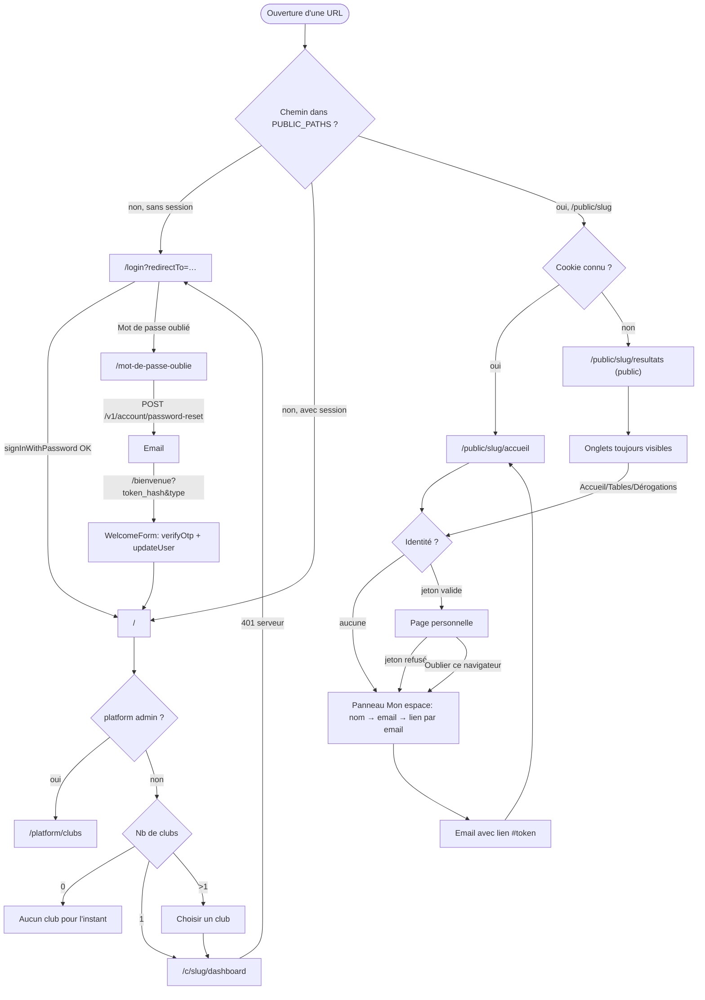

# Audit du parcours d'entrée : web vs mobile

> Audit en **lecture seule**. Aucun code modifié. Référence = web `origin/main` (production).
> Convention des preuves : `web:` = `ball-manager-web` @ `origin/main` (`9885c42`), `app:` = `ball-manager-app` @ `main` (`b17bb70`). Les chemins sont relatifs à la racine du dépôt.
> Rien n'a été exécuté : aucune app lancée, aucun appel au back. Tout ce qui suit vient de la lecture du code.

## 1. Garde-fou

| | Web | Mobile |
|---|---|---|
| pwd | `/Users/rida/Documents/dev/ball-manager-web` | `/Users/rida/Documents/dev/ball-manager-app` |
| remote | `origin https://github.com/anisfut1/ball-manager-web.git` | `origin https://github.com/anisfut1/ball-manager-app.git` |
| branche locale à l'arrivée | `fix/install-button-auth-pages` (HEAD `2c45ceab…`) | `main` (HEAD `b17bb704…`) |
| status | `?? .vscode/` (ignoré sur instruction) | vide |
| `git fetch origin` | fait ; `origin/main` = `9885c424…` | fait ; `main` = `origin/main` = `b17bb7046edc82b4240e2284c9ff39d3858715e6` |

- Le web est lu uniquement dans un worktree détaché `/tmp/ball-manager-web-main` @ `origin/main`. L'arbre de travail de l'utilisateur n'est pas touché.
- Le mobile est audité sur la branche `docs/audit-parcours-entree`, créée depuis `main`.
- Le back n'est pas ouvert. Tout comportement du back est déduit des appels et des commentaires côté clients (voir §10).

## 2. Stack détectée

**Web**
- Next.js `16.4.0` (App Router), React `19.2.8` (`web:package.json`).
- Routage par `src/proxy.ts`, qui remplace `middleware.ts` depuis Next 16 (`web:src/proxy.ts:15-17`).
- Deux régimes d'accès coexistent :
  - Compte **Supabase** (email + mot de passe), pour le staff et les admins : `/login`, `/c/{slug}/*`, `/platform/*`.
  - **Lien personnel sans compte**, pour les licenciés : `/public/{slug}/*`.
- Le back est appelé via `apiFetch` (`web:src/lib/api/client.ts:45`).

**Mobile**
- Expo SDK `~57` avec Expo Router `~57.0.25` (`main: expo-router/entry`), React Native `0.86.3` (`app:package.json`).
- Aucun compte Supabase ni mot de passe. Seul le régime licencié existe : une « session d'appareil » (secret `bmd_…`) par club, stockée dans le Keychain via `expo-secure-store` (`app:src/auth/secure-storage.ts:16-22`, `app:src/auth/session-repository.ts:4`).
- Splash maintenu pendant l'état `BOOTING` (`app:src/app/_layout.tsx:14,19-21`).
- Client typé `openapi-fetch` (`app:src/api/client.ts:23`).

## 3. Parcours web (référence)

### Mécanismes communs
- **Garde globale** : `proxy.ts` est en liste blanche `PUBLIC_PATHS = /login, /public, /bienvenue, /mot-de-passe-oublie, /.well-known, /api/aasa, /confidentialite, /support` (`web:src/config/site.ts:20`).
- **Proxy sans session** : toute autre route sans claims JWT est renvoyée vers `/login?redirectTo=<path>` (`web:src/proxy.ts:43-49`).
- **`redirectTo` jamais relu** : la valeur est posée par le proxy (`web:src/proxy.ts:47`) mais aucun autre fichier ne la lit (grep négatif sur `origin/main`). Après connexion, `signInAction` fait toujours `redirect("/")` (`web:src/server/actions/auth.ts:25`).
- **Session Supabase** : cookies gérés par `@supabase/ssr`. Le proxy appelle `getClaims()`, ce qui rafraîchit la session (`web:src/proxy.ts:40`). `getServerAuth` est lu une fois par requête (`web:src/lib/api/auth.server.ts:25-38`).
- **Session publique** : jeton personnel dans un cookie chiffré `HttpOnly` limité au club, via `/public/{slug}/session` (`web:src/app/public/[clubSlug]/session/route.ts:20-35`). Repli sur `localStorage` si l'endpoint répond 503. Un marqueur « déjà reconnu » (`KNOWN_COOKIE`) est posé (`web:…/session/route.ts:64`).

### A. Premier accès, non connecté
- **`/`** : `requireUser()` redirige vers `/login` (`web:src/app/page.tsx:24`, `web:src/lib/auth/session.ts:31-39`). Le proxy l'avait déjà fait avant (`web:src/proxy.ts:45`).
- **`/login`** : formulaire email + mot de passe, lien « Mot de passe oublié ? », mention « connexion réservée aux comptes créés par le club » (`web:src/app/login/page.tsx:35,41`, `web:src/features/auth/LoginForm.tsx:41`).
- **`/public/{slug}`** (lien club, sans compte) :
  - cookie de session ou marqueur « connu » → `/public/{slug}/accueil` ;
  - sinon → `/public/{slug}/resultats`, **page publique sans connexion** (`web:src/app/public/[clubSlug]/page.tsx:16-17`).
  - Les onglets Accueil, Équipe, Résultats, Matchs, Tables, Dérogations sont toujours visibles (`web:src/components/public/PublicNav.tsx:22-32`). L'onglet qui exige une identité affiche **sur place** un panneau « Mon espace » (nom → email) (`web:src/features/public-home/PublicHomeApp.tsx:45-46`).

### B. Inscription
- **Pas d'auto-inscription** (`web:src/app/login/page.tsx:35,41`).
- **Compte staff** : le club envoie une invitation par email. Elle arrive sur `/bienvenue?token_hash&type=invite|recovery|…&next=` (`web:src/app/bienvenue/page.tsx:8-24`). `WelcomeForm` fait :
  1. `verifyOtp` au clic, jamais à l'ouverture ;
  2. `updateUser({password})` ;
  3. rechargement complet vers `next` (par défaut `/`) (`web:src/features/account/WelcomeForm.tsx:36-54`).
  - Lien invalide ou expiré → écran « Ce lien n'est plus valable » + « Recevoir un nouveau lien » (`WelcomeForm.tsx:57-68`).
- **Licencié sans compte** : `IdentifyView` en 3 étapes (`web:src/features/public/PublicLoginApp.tsx:12-16`) :
  1. recherche prénom + nom (au moins 2 mots) → `POST /v1/public/clubs/{slug}/licencies/search` (`web:src/lib/api/publicTables.ts:161`) ;
  2. choix de la fiche, email demandé seulement si absent de la fiche → `POST …/licencies/{id}/request-link` (`web:src/lib/api/publicTables.ts:58`). Le lien part **uniquement par email** ;
  3. si le nom est introuvable : « Prévenir le club » → `POST …/access-requests` (`web:src/lib/api/publicTables.ts:167`).
  - Email différent de celui de la fiche → état `pending` : l'admin du club valide (`web:src/features/public/IdentifyView.tsx:176-199`).
- **Premier écran utile** : `/public/{slug}/accueil` (`web:src/features/mobile-auth/LoginCodeApp.tsx:28`), ou la page d'origine (`returnTo`).

### C. Connexion d'un utilisateur existant
- **Staff** : `signInAction` → `supabase.auth.signInWithPassword` → `redirect("/")`. Erreur → « Email ou mot de passe incorrect » (`web:src/lib/auth/service.ts:29-33`). Puis `/` décide (voir G).
- **Licencié** : le lien de l'email porte `#token=` (ou `?token=` pour les anciens liens).
  - `PublicIdentityProvider` lit puis retire le jeton de l'URL, le valide par `GET /v1/public/clubs/{slug}/me` et le range dans le cookie de session (`web:src/features/public/PublicIdentityProvider.tsx:72-108`).
  - Variante « lien de connexion à usage unique » : `/public/{slug}/connexion/code/{code}`. Ouvrir la page ne consomme rien ; le bouton « Me connecter » fait `POST /v1/public/clubs/{slug}/auth/token {code, platform:"web"}`, puis `location.replace(<redirectPath ou /accueil>#token=…)` (`web:src/features/mobile-auth/LoginCodeApp.tsx:23-35`, `web:src/lib/api/deviceAuth.ts:19`).

### D. Utilisateur connecté qui revient
- **Staff** : proxy OK → `/` → `requireUser` → `listUserClubs` (`GET /v1/clubs`) + `isPlatformAdmin` (`GET /v1/platform/clubs`, un 403 vaut « non admin ») (`web:src/app/page.tsx:25`, `web:src/lib/auth/platform.ts:21-31`). Redirection :
  - platform admin → `/platform/clubs` (`web:src/app/page.tsx:29`) ;
  - 1 club → `/c/{slug}/dashboard` (`web:src/app/page.tsx:31-33`).
- **`/login` avec session** : `redirect("/")` (`web:src/app/login/page.tsx:18-20`).
- **Licencié** : `/public/{slug}` → accueil (cookie), jeton revalidé par `/me` (`web:src/features/public/PublicIdentityProvider.tsx:88`).
- **PWA installée** : `start_url` = `/public/{slug}/accueil?source=pwa` (ou `/?source=pwa`), sans jeton (`web:src/lib/pwa/manifest.ts:29`). Si la PWA ne reconnaît personne, `PwaReconnectNotice` propose « Me reconnaître » (`web:src/features/pwa/PwaReconnectNotice.tsx:27-37`).

### E. Session expirée / jeton invalide
- **Staff, rendu serveur** : un 401 du back → `redirect("/login")` (`web:src/lib/api/server.ts:30-32`).
- **Staff, rendu client** : un 401 → **un** `refreshSession()`, rejeu une fois, puis `location.assign("/login")` ; aucune boucle (`web:src/lib/api/browserClient.ts:27-52`).
- **Licencié** : un jeton refusé par `/me` est retiré (appareil, session serveur, localStorage) et le candidat suivant est essayé. Si plus aucun jeton : `identity=null` → **panneau de connexion à la place de la page**, sans écran d'erreur dédié (`web:src/features/public/PublicIdentityProvider.tsx:110-120`).

### F. Mot de passe oublié
- `/login` → lien `/mot-de-passe-oublie` → `POST /v1/account/password-reset {email}`, réponse identique que le compte existe ou non (`web:src/features/account/ForgotPasswordForm.tsx:10,22`).
- Email → `/bienvenue?type=recovery` → nouveau mot de passe → connecté, redirigé vers `next` (`web:src/app/bienvenue/page.tsx:36-53`).
- Côté licencié : pas de mot de passe. « Lien perdu » = refaire la recherche de nom ; le lien repart à l'adresse déjà enregistrée (`web:src/features/public/IdentifyView.tsx:37-39`).

### G. Sans club / multi-clubs / rôle
- **Sans club** (staff) : « Aucun club pour l'instant — contactez l'administrateur » avec bouton « Se déconnecter » (`web:src/app/page.tsx:50-62`).
- **Plusieurs clubs** : liste « Choisir un club » → `/c/{slug}/dashboard` (`web:src/app/page.tsx:63-83`).
- **Club inconnu ou non membre** : 404, jamais distingué (`web:src/lib/tenancy/club-context.ts:35-40`).
- **Rôles** : la navigation vient de `club.roles` (`web:src/app/c/[clubSlug]/layout.tsx:26`) ; `/admin/*` redirige les non-admins vers `/dashboard` (`web:src/lib/tenancy/club-context.ts:43-51`). Il n'y a **pas d'écran de « choix de rôle »**.
- **Licencié, plusieurs personnes** (enfants) : plusieurs jetons par appareil, `switchTo` change l'identité active (`web:src/features/public/PublicIdentityProvider.tsx:137-152`).

### H. Invitation / lien profond
- Les liens e-mail de l'espace public sont `/public/{slug}/<section>#token=…`, avec `returnTo` fixé à la demande du lien (`web:src/lib/api/publicTables.ts:58-60`).
- `/bienvenue` accepte `next`, restreint aux chemins internes (`web:src/app/bienvenue/page.tsx:11-13`).
- Universal Links : `/.well-known/apple-app-site-association` est servi par `/api/aasa` (`web:src/app/api/aasa/route.ts`). Il capture `/public/*` et `/open/*`, et exclut `/public/*/session`, `/public/*/auth/*`, `/public/*/manifest.webmanifest`. `/c/*` n'est pas capturé (`web:src/config/ios-app.ts:25-31`).
- Smart App Banner Safari si `NEXT_PUBLIC_APP_STORE_ID` est défini (`web:src/app/public/[clubSlug]/layout.tsx:12-17`).
- Pont app : `/public/{slug}/auth/app` (SSO par PKCE depuis l'app). Si le navigateur connaît la personne : « Continuer » → `POST …/auth/codes` → redirection vers `fr.ballmanager.app://auth/callback?code&state`. Sinon, panneau de connexion avec la mention « Ouvre le lien reçu par e-mail sur ce téléphone » (`web:src/features/mobile-auth/AppSignInApp.tsx:22-50`).

### I. Déconnexion
- **Staff** : `signOutAction` → `supabase.auth.signOut()` → `redirect("/login")` (`web:src/server/actions/auth.ts:28-32`), depuis `UserMenu` ou la page `/` (`web:src/app/page.tsx:42`).
- **Licencié** : menu « Oublier ce navigateur » → `forget()` : efface localStorage, jetons d'appareil et cookie « connu », `DELETE …/session`. Reste sur la page, qui montre alors le panneau de connexion. Pas de confirmation (`web:src/components/public/PublicAccountChip.tsx:51-62`, `PublicIdentityProvider.tsx:128-135`).

## 4. Parcours mobile

### Mécanismes communs
- **Arbre de routes** (Expo Router) :
  - hors garde : `/bienvenue`, `/connexion/[clubSlug]`, `/lien`, `/code`, `/session-expiree`, `/web` ;
  - sous garde `(app)` : `(tabs)/{index,equipes,matchs,tables,plus}`, `c/[clubSlug]/*`, `resultats`, `planning`, `profil`.
- **La racine `/`** est l'onglet Accueil (`app:src/app/(app)/(tabs)/index.tsx`), donc **sous la garde**. Il n'existe pas d'écran public d'atterrissage.
- **Garde** `app:src/app/(app)/_layout.tsx:12-25`, si non connecté :
  - la destination demandée est mise de côté (`setPendingDestination`), sauf `/` ;
  - redirection vers `/session-expiree` si le statut est `EXPIRED`, sinon `/connexion/{slug}` si l'URL contient un club, sinon `/bienvenue`.
- **Machine d'état** : `BOOTING → UNAUTHENTICATED | AUTHENTICATED → REFRESHING | EXPIRED` (`app:src/auth/session-machine.ts:11-44`).
- **Au lancement** (`app:src/auth/SessionProvider.tsx:80-92`) : lecture du Keychain → `BOOTED` → app tout de suite (hors ligne compris) → `refresh()` en arrière-plan.
- **Splash** : `preventAutoHideAsync` puis `hideAsync` quand le statut n'est plus `BOOTING` (`app:src/app/_layout.tsx:14,19`). Le splash natif est configuré dans `app:app.config.ts:68-76`.
- **Retour d'arrière-plan** : `bindAppFocus` rafraîchit TanStack Query (`app:src/api/queryClient.ts:25-29`). La session n'est revalidée qu'au lancement (`SessionProvider.tsx:80-92`).

### A. Premier lancement, non connecté
1. Splash (fond noir `#111111`, logo).
2. Garde `(app)` : `/` non connecté → `<Redirect href="/bienvenue">` (`app:src/app/(app)/_layout.tsx:22`).
3. **`/bienvenue`** :
   - héros « Ball Manager » + 4 pastilles ;
   - « Choisis ton club », liste via `GET /v1/public/clubs` (`app:src/api/endpoints/auth.ts:24`) ;
   - recherche de club à partir de 7 clubs (`app:src/app/bienvenue.tsx:25,70`) ;
   - mention « Pas de compte ni de mot de passe » (`bienvenue.tsx:101-106`).
4. Tap sur un club → **`/connexion/{slug}`** : « Qui es-tu ? » + `IdentifyFlow` + bouton « Déjà connecté sur le site ? Continuer » (SSO Safari) (`app:src/app/connexion/[clubSlug].tsx:47-73`).
- Aucun onboarding à étapes. **Aucun contenu consultable sans identification.**

### B. Inscription
- Pas de compte à créer. `IdentifyFlow` reprend les mêmes appels que le web : `licencies/search`, `…/{id}/request-link` (`returnTo` par défaut), `access-requests` (`app:src/api/endpoints/identify.ts:9-13`).
- Étapes : recherche → confirmation, avec email si absent de la fiche → « lien envoyé » → l'utilisateur ouvre le mail (`app:src/features/identify/IdentifyFlow.tsx:35-69,118-133`).
- Premier écran utile : l'onglet Accueil du club (`/c/{slug}` → `<Redirect href="/">`) (`app:src/app/(app)/c/[clubSlug]/index.tsx`).
- Le dernier clic est dans l'app Mail, pas dans l'app.

### C. Connexion d'un utilisateur existant
Trois entrées, une seule sortie : une session d'appareil dans le Keychain (`app:src/auth/auth-service.ts:7-13`).
1. **Lien personnel** (Universal Link, `?token=` ou `#token=`) : `+native-intent` → `resolveDestination` → `/lien?club&token&next`. `bootstrapFromToken` fait `POST …/auth/device-sessions {tokens, platform:"ios"}`, ou `addPeople` si le club est déjà connu. Puis `router.replace(destinationAfterLogin)` (`app:src/app/lien.tsx:13-27`, `auth-service.ts:70-82`).
2. **Lien à code unique** (`/public/{slug}/connexion/code/{code}`) : `/code` → `loginWithCode` → `POST …/auth/token {code, platform:"ios"}` (`app:src/app/code.tsx:13-26`, `app:src/api/endpoints/auth.ts:32`).
3. **« Déjà connecté sur le site ? Continuer »** : `ssoLogin` ouvre `ASWebAuthenticationSession` sur `{webUrl}/public/{slug}/auth/app?code_challenge…` (PKCE), puis `exchangeCode` avec le `codeVerifier` (`auth-service.ts:91-127`). Annulation = silencieuse (`SsoCancelled`).
- Destination après connexion (`app:src/navigation/after-login.ts:10-18`) : destination en attente, sinon `redirectPath` de l'API, sinon `/c/{slug}` (= Accueil).

### D. Utilisateur connecté qui revient
- Lecture du Keychain → `AUTHENTICATED` → onglets, **sans écran de connexion ni de choix**. Revalidation en arrière-plan : `GET …/auth/session` par club (`auth-service.ts:133-152`).
- Hors ligne ou 5xx : session conservée.

### E. Session expirée / jeton invalide
- Au lancement : un 401 de `refreshAll` retire le club (`auth-service.ts:145-148`).
- En usage : un 401 « session invalide » sur n'importe quel appel d'un club → `onSessionInvalid` retire le club (`SessionProvider.tsx:95-107`).
- Il reste un autre club → l'état redevient `AUTHENTICATED`, **sans message** (`session-machine.ts:41-43`).
- Plus aucun club → `EXPIRED` → `/session-expiree` : « Reconnecte-toi… Tes données ne sont pas perdues », bouton **« Se reconnecter » → `/bienvenue`** (`app:src/app/session-expiree.tsx:4-13`).
- Le cas « club connu mais lien inconnu pour ce club » est traité par `app:src/app/(app)/c/[clubSlug]/_layout.tsx:23-42` (« Accès réservé » + « Se connecter à ce club »).

### F. Mot de passe oublié
- **N'existe pas** : pas de mot de passe. Les chemins web `/login`, `/bienvenue`, `/mot-de-passe-oublie`, `/platform` sont envoyés vers l'écran **« Disponible sur le site »** (`/web`) (`app:src/linking/resolveLegacyPath.ts:99-101`, `app:src/app/web.tsx`).
- « Lien perdu » = `IdentifyFlow` à nouveau (même mécanisme que le web côté licencié).

### G. Sans club / multi-clubs / rôle
- **Sans club** : état `UNAUTHENTICATED` → `/bienvenue` (liste de tous les clubs). Il n'y a pas d'écran « aucun club ».
- **Plusieurs clubs** : `state.clubs` contient plusieurs sessions, `active` choisit l'actif. Le changement se fait depuis le Profil (`setActiveClub`), ou automatiquement via un lien `/c/{slug}` (`app:src/app/(app)/c/[clubSlug]/_layout.tsx:19-21`). Il n'y a **pas de sélecteur au lancement**.
- **Plusieurs personnes** (enfants) : `people[]` par club, `setActivePerson` (`SessionProvider.tsx:184-190`).
- **Rôles** : lus via `useRoles` ; les libellés « Administrateur du club » etc. sont affichés au profil (`app:src/app/(app)/profil.tsx`). Pas de choix de rôle.

### H. Deep links / notifications
- Un point d'entrée unique, `+native-intent` → `resolveDestination` → `internalPathFor` (`app:src/app/+native-intent.tsx:8-14`). Il sert aussi aux notifications push (`app:src/push/PushBridge.tsx:21-25`).
- Domaine associé : `applinks:www.ball-manager.fr` (`app:app.config.ts:19,36`) ; schéma `ballmanager://`.
- Correspondances (`app:src/linking/resolveLegacyPath.ts:28-103`) :
  - `/public/{slug}` et `/accueil` → `/c/{slug}` ;
  - `/connexion/code/{code}` → `/code` ;
  - `/public/{slug}/(matchs|resultats)/{id}` → `/c/{slug}/matchs/{id}` ;
  - `/public/{slug}/(matchs|resultats)` **sans id → `/c/{slug}/planning`** (ligne 47) ;
  - `/c/{slug}/admin/*` → écran `/web` ;
  - domaine étranger → ignoré.
- Une destination qui exige une session met l'utilisateur sur `/connexion/{slug}` avec la bannière « Après la connexion, tu arriveras directement sur la page demandée » (`app:src/app/connexion/[clubSlug].tsx:56`).

### I. Déconnexion
- Profil → « Se déconnecter » → `Alert` de confirmation (« Tu ne recevras plus les notifications de {club} sur cet appareil ») → `logout(club)` (`app:src/app/(app)/profil.tsx:82-84,180`).
- `logout` fait, dans l'ordre : détachement du jeton push, `DELETE …/auth/session`, Keychain, cache, destination en attente (`SessionProvider.tsx:155-160`).
- Dernier club → `UNAUTHENTICATED` → `/bienvenue`.
- **Suppression de compte** : Profil → « Supprimer mon compte » → `DELETE …/auth/me` pour chaque club, un par un (`app:src/features/account/DeleteAccountSection.tsx`, `auth-service.ts:189-201`).

### Spécificités mobiles
- **Notifications** :
  - jamais demandées au lancement ;
  - `PushInvite` apparaît sur l'Accueil, après connexion, seulement si la permission est « undetermined » ; la demande système part au tap sur « Activer les notifications » (`app:src/features/home/PushInvite.tsx:6-10`, `app:src/push/registration.ts:43-48`) ;
  - jeton APNs enregistré par club : `PUT …/auth/session/push-token`.
- **Autres permissions** : aucune. Pas de Face ID (`expo-secure-store` avec `faceIDPermission:false`, `app.config.ts:66`).
- **Plateforme** : `platform:"ios"` et `deviceLabel:"iPhone"` sont codés en dur (`app:src/api/endpoints/auth.ts:29,33`, `SessionProvider.tsx:23`), alors que `app.config.ts:54-62` déclare aussi un package Android.

## 5. Diagrammes

### Web



### Mobile

```mermaid
flowchart TD
  S([Lancement]) --> SP[Splash maintenu: BOOTING]
  SP --> KC{Keychain: au moins un club ?}
  KC -- non --> UN[UNAUTHENTICATED]
  KC -- oui --> AU["AUTHENTICATED: onglets (revalidation en arrière-plan)"]
  UN --> G["Garde (app): / → /bienvenue"]
  G --> B["/bienvenue: choisir son club (GET /v1/public/clubs)"]
  B --> CX["/connexion/slug: Qui es-tu ?"]
  CX --> IF["IdentifyFlow: nom → email → lien envoyé"]
  IF --> MAIL[Email: ouvrir sur le téléphone]
  CX -->|Déjà connecté sur le site ?| SSO["ASWebAuthenticationSession + PKCE → /public/slug/auth/app"]
  SSO --> XC["POST /auth/token + codeVerifier"]
  MAIL -->|Universal Link| NI["+native-intent → resolveDestination"]
  NI -->|"?token / #token"| LI["/lien → POST /auth/device-sessions"]
  NI -->|"/connexion/code/…"| CO["/code → POST /auth/token"]
  LI --> AFT[destinationAfterLogin]
  CO --> AFT
  XC --> AFT
  AFT -->|"destination en attente ou /c/slug"| AU
  AU -->|401 sur un club| ONE{Autres clubs restants ?}
  ONE -- oui --> AU
  ONE -- non --> EX["EXPIRED: /session-expiree"] --> B
  AU -->|Se déconnecter (confirmation)| OUT{Club restant ?}
  OUT -- oui --> AU
  OUT -- non --> B
  AU -->|chemins /login /bienvenue /platform /c/slug/admin| WEB["/web: Disponible sur le site"]
```

## 6. Tableau comparatif par scénario

### A. Premier accès, non connecté
| Étape | Web | Mobile | Écart |
|---|---|---|---|
| Écran d'atterrissage | `/login` (staff) ou `/public/{slug}/resultats` (licencié, public) — `web:src/proxy.ts:46`, `web:src/app/public/[clubSlug]/page.tsx:17` | `/bienvenue` — `app:src/app/(app)/_layout.tsx:22` | Écarts 1, 2 |
| Contenu sans identification | Résultats et Matchs publics, onglets visibles — `web:src/components/public/PublicNav.tsx:16-21` | Aucun, tout est sous garde — `app:src/app/(app)/_layout.tsx:12-25` | Écart 1 |
| Choix du club | Implicite : l'URL contient le slug | Liste de tous les clubs — `app:src/app/bienvenue.tsx:29` | Justifié (A1), voir §9 |
| Identification | Panneau sur place, stepper « Ton nom → Ton email → Ton espace » — `web:src/features/public/PublicLoginApp.tsx:12-16` | Écran dédié « Qui es-tu ? », sans stepper — `app:src/app/connexion/[clubSlug].tsx:52-55` | Écart 8 |

### B. Inscription
| Étape | Web | Mobile | Écart |
|---|---|---|---|
| Compte staff | Invitation → `/bienvenue` → mot de passe — `web:src/features/account/WelcomeForm.tsx:36-54` | Aucun (écran `/web`) — `app:src/linking/resolveLegacyPath.ts:99` | Écart 4 |
| Licencié : recherche, email, demande d'accès | `search`, `request-link`, `access-requests` — `web:src/lib/api/publicTables.ts:58,161,167` | Mêmes 3 appels — `app:src/api/endpoints/identify.ts:9-13` | Aucun |
| Premier écran | `/public/{slug}/accueil` ou `returnTo` | `/c/{slug}` → onglet Accueil — `app:src/navigation/after-login.ts:17` | Aucun |

### C. Connexion
| Étape | Web | Mobile | Écart |
|---|---|---|---|
| Email + mot de passe | `/login` — `web:src/features/auth/LoginForm.tsx` | Absent | Écart 4 |
| Lien personnel | `#token` lu puis retiré, cookie de session — `web:src/features/public/PublicIdentityProvider.tsx:72-108` | `/lien` → `device-sessions` → Keychain — `app:src/app/lien.tsx:21-23` | Mécanisme équivalent (justifié, A2) |
| Lien à code unique | Bouton « Me connecter » (`platform:"web"`) — `web:src/features/mobile-auth/LoginCodeApp.tsx:27` | `/code` : l'échange part dès l'ouverture de l'écran — `app:src/app/code.tsx:18-24` | Écart 9 |
| SSO Safari | `/public/{slug}/auth/app` — `web:src/features/mobile-auth/AppSignInApp.tsx` | « Déjà connecté sur le site ? Continuer » — `app:src/app/connexion/[clubSlug].tsx:66-73` | Justifié (A4) |
| Après connexion | `redirect("/")` (staff), page d'origine (licencié) | Destination en attente, sinon accueil — `app:src/navigation/after-login.ts` | Écart 5 pour le `redirectTo` staff |

### D. Utilisateur connecté qui revient
| Étape | Web | Mobile | Écart |
|---|---|---|---|
| Premier écran | `/` → `/c/{slug}/dashboard` (1 club) ; `/public/{slug}` → accueil | Onglet Accueil du club actif — `app:src/auth/SessionProvider.tsx:80-92` | Aucun pour le licencié |
| Écran de connexion | Jamais (`/login` → `/`) | Jamais | Aucun |
| Revalidation | Proxy `getClaims` à chaque requête — `web:src/proxy.ts:40` | `GET …/auth/session` au lancement seulement — `app:src/auth/auth-service.ts:133-152` | Justifié (A6) |

### E. Session expirée
| Étape | Web | Mobile | Écart |
|---|---|---|---|
| Staff | `/login` après un refresh tenté — `web:src/lib/api/browserClient.ts:27-52` | Absent | Écart 4 |
| Licencié, jeton refusé | Retiré, panneau de connexion à la place de la page — `web:src/features/public/PublicIdentityProvider.tsx:110-120` | Un club : retiré sans message ; dernier club : `/session-expiree` — `app:src/auth/session-machine.ts:41-43` | Écart 3 |
| Rebond | Formulaire sur place pour **le même club** | `/session-expiree` → `/bienvenue` (liste de tous les clubs) — `app:src/app/session-expiree.tsx:13` | Écart 3 |

### F. Mot de passe oublié
| Étape | Web | Mobile | Écart |
|---|---|---|---|
| Staff | `/mot-de-passe-oublie` → email → `/bienvenue?type=recovery` | Écran `/web` | Écart 4 |
| Licencié | Refaire la recherche de nom | Refaire `IdentifyFlow` | Aucun |

### G. Sans club / multi-clubs / rôle
| Étape | Web | Mobile | Écart |
|---|---|---|---|
| Sans club | Écran « Aucun club pour l'instant » — `web:src/app/page.tsx:50-62` | Retour à `/bienvenue` | Écart 4 |
| Multi-clubs | Liste « Choisir un club » à l'arrivée — `web:src/app/page.tsx:63-83` | Club actif mémorisé, changement depuis le Profil — `app:src/app/(app)/profil.tsx` | Écart 7 |
| Rôles | Navigation filtrée par `club.roles` | Libellés de rôle au Profil, navigation unique | Non déterminé (§10) |
| Plusieurs personnes | `switchTo` — `web:src/features/public/PublicIdentityProvider.tsx:137-152` | `setActivePerson` — `app:src/auth/SessionProvider.tsx:184-190` | Aucun |

### H. Lien profond
| Étape | Web | Mobile | Écart |
|---|---|---|---|
| `/public/{slug}/resultats` sans compte | Page publique — `web:src/app/public/[clubSlug]/page.tsx:17` | Résolu en `/c/{slug}/planning`, donc sous garde — `app:src/linking/resolveLegacyPath.ts:41-47` | Écart 2 |
| `/public/{slug}/matchs/{id}` sans session | Page publique | Garde → `/connexion/{slug}` | Écart 2 |
| `/c/{slug}/admin/*` | Page admin (compte) | Écran `/web` — `app:src/linking/resolveLegacyPath.ts:95-96` | Justifié (A5) |
| Domaine étranger | Sans objet | Ignoré — `app:src/app/+native-intent.tsx:8-14` | Aucun |

### I. Déconnexion
| Étape | Web | Mobile | Écart |
|---|---|---|---|
| Libellé | « Oublier ce navigateur » (licencié), « Se déconnecter » (staff) — `web:src/components/public/PublicAccountChip.tsx:61` | « Se déconnecter » — `app:src/app/(app)/profil.tsx:180` | Écart 6 |
| Confirmation | Aucune | `Alert` de confirmation — `profil.tsx:82-84` | Écart 6 |
| Après | Reste sur la page (licencié) ou `/login` (staff) — `web:src/server/actions/auth.ts:31` | `/bienvenue` si dernier club | Écart 6 |
| Suppression de compte | Aucune (grep négatif sur `origin/main`) | Présente — `app:src/features/account/DeleteAccountSection.tsx` | Écart 10 |

## 7. Écarts numérotés

**Compte : 0 Bloquant · 6 Majeur · 4 Mineur.** Les 10 écarts viennent de la lecture du code ; aucun n'a été reproduit sur un appareil.

1. **Majeur — Aucun contenu avant identification sur le mobile.**
   - Web : `/public/{slug}` mène à `/resultats`, public, avec les onglets visibles. L'identification se fait sur place (`web:src/app/public/[clubSlug]/page.tsx:17`, `web:src/features/public-home/PublicHomeApp.tsx:46`).
   - Mobile : tout est sous garde, `/` renvoie sur `/bienvenue` (`app:src/app/(app)/_layout.tsx:12-25`).
   - Piste : exposer Résultats et Matchs du club choisi avant connexion, comme le web.
   - Voir aussi §8 (relecture App Store).
2. **Majeur — Liens `/public/{slug}/resultats|matchs` ouverts sans session : connexion exigée sur le mobile, résolue vers le planning.**
   - Web : pages publiques (`web:src/app/public/[clubSlug]/page.tsx:17`).
   - Mobile : `/public/{slug}/resultats` sans id → `/c/{slug}/planning` (`app:src/linking/resolveLegacyPath.ts:47`), alors qu'un écran `/resultats` existe (`app:src/app/(app)/(tabs)/plus.tsx:33`).
   - Piste : router `/resultats` vers l'écran Résultats, et permettre la lecture sans session.
3. **Majeur — Session expirée : écran dédié puis liste de tous les clubs, au lieu de revenir au club concerné.**
   - Web : jeton refusé → panneau de connexion du même club, sur place (`web:src/features/public/PublicIdentityProvider.tsx:110-120`).
   - Mobile : `/session-expiree` → `/bienvenue` (`app:src/app/session-expiree.tsx:13`). Avec plusieurs clubs, la perte d'un club est silencieuse (`app:src/auth/session-machine.ts:41-43`).
   - Piste : renvoyer vers `/connexion/{clubSlug}` du dernier club, et signaler le club perdu.
4. **Majeur — Parcours par compte (staff/admin) absents de l'app.**
   - Web : `/login`, `/mot-de-passe-oublie`, `/bienvenue` (invitation), `/c/{slug}/*`, `/platform/*`.
   - Mobile : tout renvoie à l'écran « Disponible sur le site » (`app:src/linking/resolveLegacyPath.ts:99-101`).
   - Piste : décision produit à confirmer. Si l'app reste réservée aux licenciés, le dire clairement sur `/bienvenue`.
5. **Mineur — `redirectTo` posé par le proxy mais jamais utilisé côté web.**
   - Web : `web:src/proxy.ts:47` pose `redirectTo`, `web:src/server/actions/auth.ts:25` ignore et redirige vers `/`.
   - Mobile : le même besoin est résolu par `pendingDestination` (`app:src/linking/pendingDestination.ts`).
   - Piste : à ne pas copier ; c'est le mobile qui est ici le plus abouti.
6. **Majeur — Déconnexion : libellé, confirmation et rebond différents.**
   - Web (licencié) : « Oublier ce navigateur », sans confirmation, reste sur la page (`web:src/components/public/PublicAccountChip.tsx:51-62`).
   - Mobile : « Se déconnecter » avec confirmation, purge push + serveur, puis `/bienvenue` (`app:src/app/(app)/profil.tsx:82-84`).
   - Piste : aligner le libellé et le comportement attendu après déconnexion ; garder la confirmation côté mobile.
7. **Majeur — Choix du club : liste imposée à l'arrivée sur le web (staff), club mémorisé sur le mobile.**
   - Web : si plusieurs clubs, « Choisir un club » à chaque passage par `/` (`web:src/app/page.tsx:63-83`).
   - Mobile : le club actif est mémorisé, le changement se fait depuis le Profil (`app:src/app/(app)/c/[clubSlug]/_layout.tsx:19-21`).
   - Piste : décider si le mobile propose un sélecteur au lancement quand plusieurs clubs sont connectés.
8. **Mineur — Libellés et stepper de l'écran d'identification.**
   - Web : « Espace licenciés », « Connexion », stepper « Ton nom → Ton email → Ton espace » (`web:src/features/public/PublicLoginApp.tsx:12-16,41-44`).
   - Mobile : « Qui es-tu ? », sans stepper (`app:src/app/connexion/[clubSlug].tsx:52-55`).
   - Piste : reprendre les libellés et les trois étapes.
9. **Mineur — Lien à code unique : bouton sur le web, échange automatique sur le mobile.**
   - Web : l'échange part au clic sur « Me connecter » (`web:src/features/mobile-auth/LoginCodeApp.tsx:47`).
   - Mobile : l'échange part à l'ouverture de l'écran (`app:src/app/code.tsx:18-24`).
   - Le commentaire de `app:src/app/code.tsx:9-12` justifie l'échange par un POST fait par l'app ; l'effet sur un lien préchargé par un scanner d'email n'a pas été vérifié.
   - Piste : décider si le mobile doit aussi attendre un geste avant d'échanger le code.
10. **Mineur — Suppression de compte : présente sur le mobile, absente côté web.**
    - Web : aucune occurrence sur `origin/main` (grep négatif).
    - Mobile : Profil → « Supprimer mon compte » (`app:src/features/account/DeleteAccountSection.tsx`).
    - Piste : écart dans le sens inverse ; à traiter côté web seulement si le produit le demande.

## 8. Vigilance App Store

Aucune règle Apple n'a été vérifiée par moi : je n'ai pas consulté les guidelines. Les références ci-dessous sont celles qui figurent dans le code ou la doc du dépôt mobile.

- **Écran bloquant sans compte** (écart 1). Le seul écran accessible sans identification est le choix du club puis la recherche de nom. L'accès au contenu dépend d'un lien reçu par email, donc d'une fiche licencié existante.
  - À vérifier : la note au relecteur (`app:docs/APP_STORE.md:55-66`) fournit un compte de démonstration ; s'assurer que ce chemin fonctionne sans fiche réelle.
- **Création de compte dans l'app** : aucune. L'utilisateur est « identifié » par le club.
- **Suppression de compte** : présente (Profil → « Supprimer mon compte »). Le code cite la règle 5.1.1(v) (`app:src/features/account/DeleteAccountSection.tsx:11`, `app:docs/APP_STORE.md:75`). Citation non vérifiée par moi.
- **Connexion tierce** : aucune connexion via un service tiers. Le SSO de l'app passe par le site du produit, via `ASWebAuthenticationSession`.
- **Revue** : `app:docs/APP_STORE.md:34` mentionne la guideline 4.2 (fonctionnalité minimale). Non revérifiée.
- **Privacy manifest** : le dépôt le note lui-même « non vérifié sur une build réelle » (`app:docs/APP_STORE.md:90`).
- **Android** : `app.config.ts:54-62` déclare un package Android, mais `platform:"ios"` est codé en dur dans les appels d'authentification (`app:src/api/endpoints/auth.ts:29,33`) et le push est limité à iOS (`app:src/push/registration.ts:45`).

## 9. Écarts justifiés par la plateforme (non comptés)

- **A1. Liste des clubs** sur `/bienvenue` : l'app n'a pas d'URL de club à ouvrir (`app:src/app/bienvenue.tsx:29`). Ce que le web fait avec le slug de l'URL, l'app doit le demander.
- **A2. Stockage de session** : Keychain `AFTER_FIRST_UNLOCK_THIS_DEVICE_ONLY` côté app, cookie `HttpOnly` côté web (`app:src/auth/secure-storage.ts:16`, `web:src/app/public/[clubSlug]/session/route.ts:57-63`).
- **A3. Splash / `BOOTING`** : évite un flash entre connexion et accueil (`app:src/app/_layout.tsx:13-21`). Pas d'équivalent web.
- **A4. SSO Safari + PKCE** (« Déjà connecté sur le site ? Continuer ») : `ASWebAuthenticationSession` n'existe que sur l'app (`app:src/auth/auth-service.ts:91-127`).
- **A5. Écran `/web`** pour l'administration : la gestion du club (FFBB/FBI, imports) reste sur le site (`app:src/linking/resolveLegacyPath.ts:95-96`).
- **A6. Revalidation** au lancement seulement + `bindAppFocus` pour les données : le cycle de vie natif n'a pas d'équivalent exact du proxy web (`app:src/api/queryClient.ts:25-29`).
- **A7. Permission de notifications** : invitation après connexion, demande système au tap (`app:src/features/home/PushInvite.tsx`) ; le web a `subscribeToPush` (`web:src/lib/push/client.ts:46-52`) mais la fonction n'est appelée nulle part dans `origin/main`.
- **A8. Invite d'installation PWA** (« Ajouter à l'écran d'accueil ») : inutile dans l'app ; masquée aussi sur iPhone dès que l'app publiée est proposée (`web:src/features/pwa/should-show-install.ts:13-18`).
- **A9. Universal Links / AASA** : `/c/*` volontairement non capturé, les pages `auth/*` et `session` restent dans Safari (`web:src/config/ios-app.ts:25-31`).

## 10. Points non déterminés

- **Comportement du back** : non lu (dépôt interdit). Non déterminé :
  - l'effet exact de `returnTo`, de `redirectPath` et de la validation `pending` par l'admin ;
  - le contenu du refus « session invalide » (`sessionExpired`, `app:src/api/errors.ts`) ;
  - la durée de vie des sessions : 180 jours évoqués dans `app:src/app/session-expiree.tsx:4`, non confirmés côté back ;
  - la différence réelle entre `platform:"web"` et `platform:"ios"`.
- **Rôles dans la navigation mobile** : `useRoles` a été repéré (`app:src/features/roles/useRoles.ts`) mais pas lu en entier ; je ne sais pas si la navigation mobile se filtre par rôle comme le web.
- **Navigation après changement de club** : le comportement exact du Profil (`setActiveClub`) n'a pas été vérifié écran par écran.
- **`web:src/lib/push/client.ts`** : `subscribeToPush` n'est appelé nulle part ; non déterminé si le push web est réellement activé en production.
- **Variables d'environnement de production** (`NEXT_PUBLIC_APP_STORE_ID`, `SESSION_SECRET`, `EXPO_PUBLIC_API_URL`) : non lisibles ; le repli localStorage du web (503) n'est donc pas confirmé comme actif ou non.
- **Doc embarquée** : `app:docs/AUTH.md` et `app:docs/MOBILE_PARITY_MATRIX.md` existent mais n'ont pas été relus ; ils pourraient contenir des décisions produit qui expliquent certains écarts.
- **Annexe web** : voir §11.

## 11. Annexe — Changements à venir côté web (`fix/install-button-auth-pages`)

Demandé : `git diff --stat origin/main...fix/install-button-auth-pages`.

- **Sortie : vide.** La branche est entièrement contenue dans `origin/main` (`git merge-base --is-ancestor` vrai), sans commit propre : `git log origin/main..fix/install-button-auth-pages` est vide.
- Aucun fichier du parcours d'entrée n'est donc à signaler : **aucun changement à venir côté web via cette branche**. Les 3 derniers commits de cette branche (`d0980fe`, `cfaeea0`, `2c45cea`) sont déjà dans `origin/main`. Ils masquent l'invite d'installation sur les pages de connexion et renomment l'invite (`web:src/features/pwa/should-show-install.ts:3-17`).
- Le diff à deux points (`origin/main fix/…`) montre l'inverse (60 fichiers, surtout `video/`) : c'est `origin/main` qui a avancé après la branche ; ce n'est pas un changement à venir.

## 12. Proposition d'ordre cible (mobile, aligné sur le web)

Sous réserve de la décision produit de l'écart 4.

1. Splash (inchangé).
2. Club mémorisé et session valide → Accueil du club actif (inchangé).
3. Sinon : choix du club (`/bienvenue`), avec accès direct aux Résultats et Matchs publics (écart 1).
4. Onglets visibles ; Accueil, Tables et Dérogations affichent le panneau « Mon espace » tant qu'aucune identité n'est reconnue.
5. Panneau d'identification : nom → email → lien envoyé (3 étapes, mêmes libellés que le web).
6. Email → Universal Link → échange de la session → destination d'origine (`pendingDestination`), sinon Accueil.
7. Session refusée → retour au panneau d'identification du même club (écart 3).
8. Plusieurs clubs : sélecteur au lancement, ou club mémorisé (écart 7, à trancher).
9. Déconnexion : libellé et rebond alignés (écart 6), confirmation conservée.
10. Parcours par compte : écran « Disponible sur le site » (inchangé, écart 4).

## 13. Marche à suivre pour vérifier (par scénario, à faire à la main)

Comptes à utiliser : un licencié réel du club de démonstration (`club-demo`) pour le mobile et le web ; un compte staff pour le web uniquement. Ne **jamais** supprimer le licencié du compte de revue Apple (`app:docs/APP_STORE.md:84`).

| Sc. | Web | Mobile |
|---|---|---|
| A | Navigation privée → `/` : attendu `/login`. Puis `/public/club-demo` : attendu `/resultats` public, onglets visibles. | App neuve → attendu `/bienvenue`, sans aucun contenu public. |
| B | Sur `/public/club-demo/accueil` : saisir nom + prénom → email → vérifier le mail reçu. | Même parcours depuis `/connexion/club-demo`. |
| C | Ouvrir le lien reçu : attendu `/accueil` identifié. Tester aussi un lien `/connexion/code/…` (bouton « Me connecter »). | Ouvrir le même lien sur l'iPhone : attendu connexion directe. Tester « Déjà connecté sur le site ? Continuer ». |
| D | Rouvrir `/public/club-demo` : attendu `/accueil`. | Tuer puis rouvrir l'app : attendu l'Accueil, sans écran de connexion. |
| E | Faire réinitialiser le lien par le club, recharger : attendu panneau de connexion à la place de la page. | Même opération : attendu `/session-expiree` puis `/bienvenue` (écart 3). Avec 2 clubs, vérifier la perte silencieuse. |
| F | Staff : `/mot-de-passe-oublie` → email → `/bienvenue?type=recovery`. | Ouvrir ce lien sur l'iPhone : attendu écran « Disponible sur le site ». |
| G | Staff 0 / 1 / plusieurs clubs : comparer `/`. | Connecter 2 clubs : vérifier l'absence de sélecteur au lancement et le changement via Profil. |
| H | Sans session, ouvrir `/public/club-demo/resultats` : attendu page publique. | Même lien sur l'iPhone sans session : attendu connexion exigée (écart 2). |
| I | Menu « Oublier ce navigateur » : attendu panneau de connexion. Staff : « Se déconnecter » → `/login`. | Profil → « Se déconnecter » : attendu confirmation puis `/bienvenue` si dernier club. |
